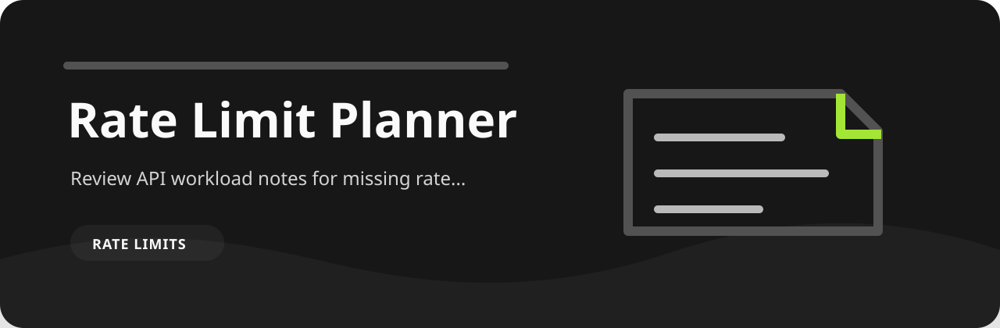

# Rate Limit Planner



Review API workload notes for missing rate limits, retries, and backoff.

`Python`

## Start here

```bash
git clone https://github.com/mertefekurt/rate-limit-planner.git
cd rate-limit-planner
python -m pip install -e ".[dev]"
rate-limit-planner examples/sample.txt
```

## Repository

[Open the source on GitHub →](https://github.com/mertefekurt/rate-limit-planner)

[MIT License](LICENSE)
